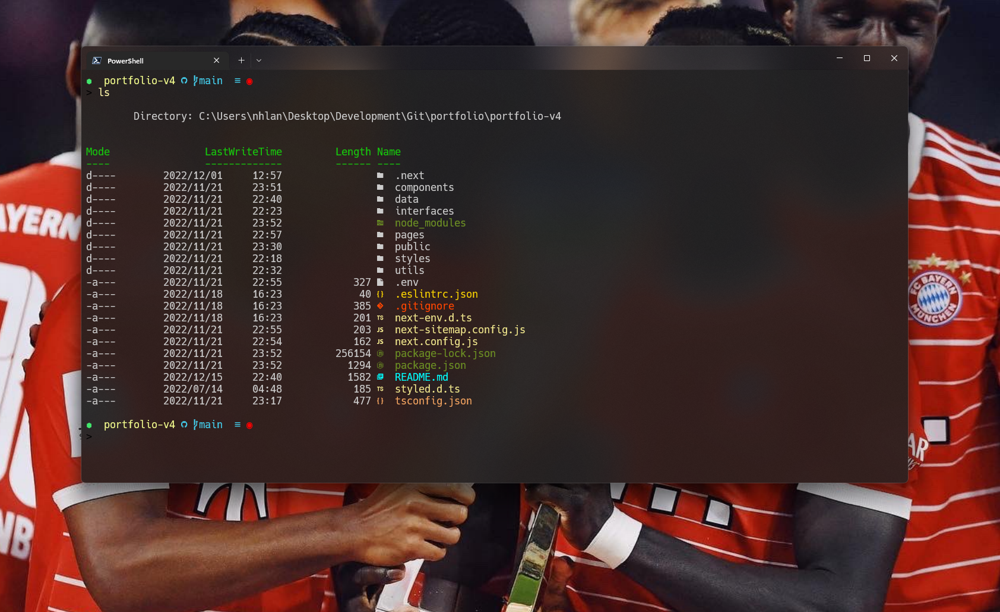
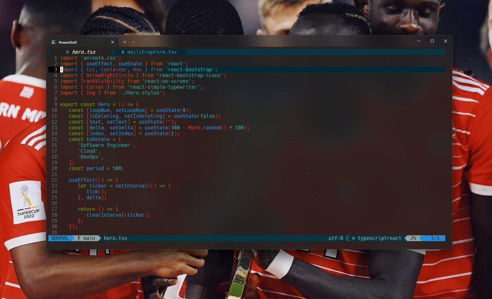
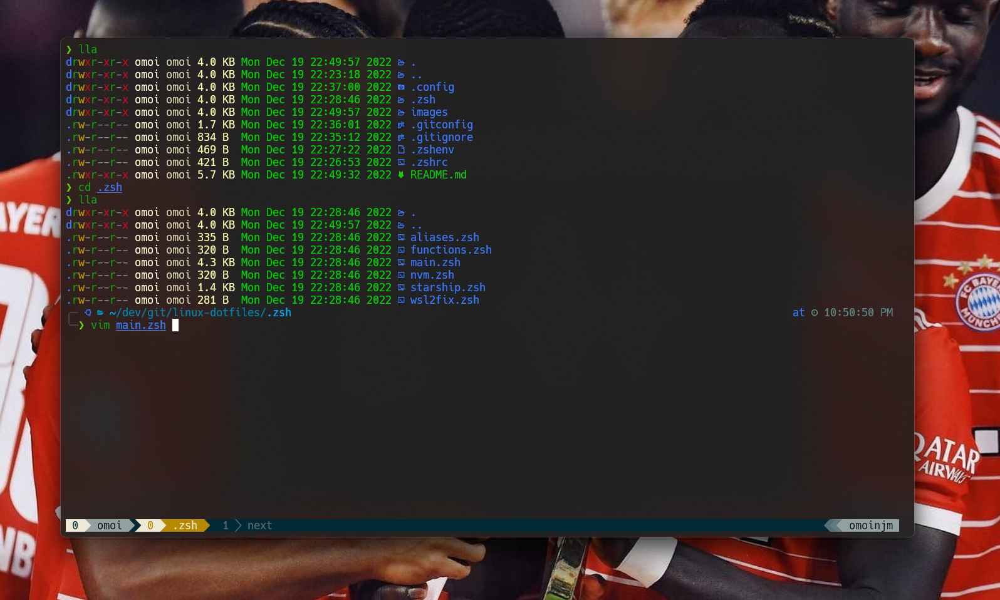
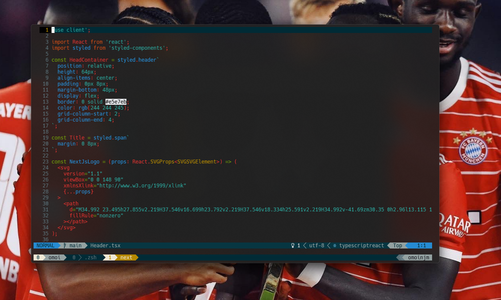

# Personal dotfiles

Cross-platform configs for Fish, Neovim (LazyVim), tmux, lazygit, Linux shells, and Windows PowerShell.

`POWERSHELL`


`NEOVIM`


`ZSH`


`TMUX`


## Repository layout

```
dotfiles/
├── .chezmoiroot           # tells chezmoi the source state lives in home/
├── home/                  # chezmoi source state → applied to ~
│   ├── .chezmoi.toml.tmpl     config for the dotfiles chezmoi instance (symlink mode)
│   ├── .chezmoiignore         repo-only files, per-OS exclusions
│   ├── .chezmoiscripts/       fisher update, tmux plugins
│   └── private_dot_config/    → ~/.config (kept chmod 700)
│       ├── fish/
│       ├── nvim/
│       ├── tmux/
│       ├── lazygit/
│       ├── git/
│       └── oh-my-posh/        local prompt theme (no download at shell start)
├── platform/
│   ├── linux/shell/       # bash and zsh
│   ├── linux/scripts/     # OS-specific automation
│   └── windows/           # PowerShell, Terminal, VS Code, starship
├── secrets/               # Example templates only — never commit real values
├── install/               # Bootstrap: runs chezmoi with the dotfiles config
└── tests/                 # CI checks
```

| Path | Purpose |
|------|---------|
| `home/` | chezmoi source state for `~` (XDG configs shared across machines) |
| `platform/linux/` | Linux-only shell and script setup |
| `platform/windows/` | Windows-only PowerShell and app settings |
| `secrets/` | Copy these examples locally and fill in your values |

## Quick start

### 1. Clone the repo

```bash
git clone https://github.com/omoinjm/.dotfiles.git ~/dotfiles
cd ~/dotfiles
```

### 2. Apply the configs to your home directory

```bash
./install/install.sh
```

This runs `install/link.sh`, which installs [chezmoi](https://www.chezmoi.io/) if needed and applies
`home/` to `~` — `fish`, `nvim`, `tmux`, `lazygit`, `git` and `oh-my-posh` under `~/.config`.
It then installs the fish plugins (fisher) and tmux plugins (tpm).

Apply only some apps, or preview first:

```bash
./install/link.sh fish nvim
./install/link.sh -- --dry-run --verbose
```

### How chezmoi is set up here

- **Symlink mode.** Each file in `~/.config/<app>/` is a symlink to its file in `home/`, so editing
  `~/.config/fish/config.fish` edits the repo — just commit. Files apps create at runtime
  (`fish_variables`, fisher plugins, `tmux/plugins/`, secrets) stay real files in `~/.config` and never
  touch the repo.
- **New file?** Create it in `home/private_dot_config/<app>/` and run `dot apply`, or create it in
  `~/.config` and run `dot add <file>`.
- **Its own config.** This instance uses `~/.config/chezmoi-dotfiles/chezmoi.toml`. The default
  `~/.config/chezmoi/` belongs to [machine-snapshot](https://github.com/omoinjm/machine-snapshot), so use
  the `dot` fish function (`dot status`, `dot diff`, `dot apply`) rather than plain `chezmoi` here.
- **Names.** `private_dot_config` → `~/.config` with mode 700; `dot_foo` → `.foo`. See the
  [chezmoi docs](https://www.chezmoi.io/reference/source-state-attributes/).

### 3. Set up local secrets

Secrets are **not** stored in git. Copy the examples and edit them on each machine:

```bash
cp secrets/fish/secrets.fish.example ~/.config/fish/conf.d/secrets.fish
cp secrets/fish/ssh.fish.example ~/.config/fish/conf.d/ssh.fish
```

Fish loads these automatically via `conf.d/00-local.fish`. See [secrets/README.md](./secrets/README.md) for Discord and password-store setup.

### 4. Run tests (optional)

```bash
bash tests/run.sh
```

## Linux and macOS

### Fish

Plugins are listed in `home/private_dot_config/fish/fish_plugins` and installed by
[Fisher](https://github.com/jorgebucaran/fisher). Applying runs `fisher update` automatically
whenever that file changes; the plugin files themselves are not tracked:

- [Fisher](https://github.com/jorgebucaran/fisher) — plugin manager
- [bass](https://github.com/edc/bass) — run bash utilities from fish
- [z](https://github.com/jethrokuan/z) — directory jumping
- [fzf.fish](https://github.com/patrickf1/fzf.fish) — fuzzy finder bindings

Optional shell theme: [Tide](https://github.com/IlanCosman/tide) v5 (`fisher install ilancosman/tide@v5`).

Machine-specific overrides go in `~/.config/fish/config-local.fish` (gitignored). Create it by copying patterns from `config-linux.fish`, `config-osx.fish`, or `config-windows.fish` as needed.

Useful Fish functions:

```fish
sys_cleanup       # clear package manager and app caches
sys_cleanup_due   # run cleanup only once per day
```

### Bash and Zsh

Linux shell configs live under `platform/linux/shell/`. They are not auto-linked — wire them up manually, for example:

```bash
# Bash: source from your ~/.bashrc
source ~/dotfiles/platform/linux/shell/bash/.bashrc

# Zsh: source from your ~/.zshrc
source ~/dotfiles/platform/linux/shell/zsh/.zshrc
```

See [platform/linux/shell/README.md](./platform/linux/shell/README.md) for direnv and symlink notes.

### Neovim

Requires [Neovim](https://neovim.io/) >= 0.9. Config is based on [LazyVim](https://www.lazyvim.org/).

After linking:

```bash
nvim
```

LazyVim installs plugins on first launch. Custom config lives in `home/private_dot_config/nvim/lua/`.

### tmux and lazygit

Applied by `./install/install.sh`. Config files:

- tmux: `home/private_dot_config/tmux/tmux.conf`
- lazygit: `home/private_dot_config/lazygit/config.yml`

### git

`home/private_dot_config/git/` is applied to `~/.config/git` (git's XDG config location):

- `config` – shared settings, nvim as diff/merge tool
- `aliases.gitconfig` – `git st`, `git hist`, `git ps`, `git open`, …
- `delta.gitconfig` – [delta](https://github.com/dandavison/delta) pager; falls back to `less` when delta isn't installed (`sudo apt install git-delta`)
- `ignore` – global gitignore

Identity stays out of the repo: put `[user] name/email` in `~/.gitconfig`, which git reads after `~/.config/git/config`.

### Secret scanning

CI runs [gitleaks](https://github.com/gitleaks/gitleaks) over the full history. To scan before each commit too:

```bash
uv tool install pre-commit && pre-commit install
```

## Windows

### PowerShell

Profile entry point: `platform/windows/powershell/user_profile.ps1`

Add to your PowerShell profile (`$PROFILE`):

```powershell
. "$HOME\dotfiles\platform\windows\powershell\user_profile.ps1"
```

Helpers live under `platform/windows/powershell/helpers/`. Discord webhook helpers read from environment variables — see `secrets/discord/env.example`.

### Terminal, VS Code, and WSL

App-specific settings are in `platform/windows/appsettings/`:

- `msterminal/` — Windows Terminal
- `vscode/` — VS Code
- `wsl/` — WSL config

### Starship

Prompt themes: `platform/windows/starship/`

## Secrets and local files

Never commit real credentials. These paths are gitignored:

| File | Purpose |
|------|---------|
| `~/.config/fish/conf.d/secrets.fish` | GPG passphrase and other env secrets |
| `~/.config/fish/conf.d/ssh.fish` | SSH agent socket overrides |
| `~/.config/fish/config-local.fish` | Machine-specific Fish config |
| `~/.config/fish/.last_cleanup_date` | Written by `sys_cleanup` |

Templates and setup instructions: [secrets/README.md](./secrets/README.md)

## Dependencies

### Fish (macOS and Linux)

- [Nerd Font](https://github.com/ryanoasis/nerd-fonts) (e.g. Hack) for prompt icons
- [Oh My Posh](https://ohmyposh.dev/) — loaded in `config.fish`
- [fzf](https://github.com/junegunn/fzf) — fuzzy finder
- Optional: [eza](https://github.com/eza-community/eza), [lsd](https://github.com/lsd-rs/lsd), [colorls](https://github.com/athityakumar/colorls)

### PowerShell (Windows)

- [Scoop](https://scoop.sh/)
- [Oh My Posh](https://ohmyposh.dev/)
- [Terminal Icons](https://github.com/devblackops/Terminal-Icons)
- [PSReadLine](https://docs.microsoft.com/en-us/powershell/module/psreadline/)
- [PSFzf](https://github.com/kelleyma49/PSFzf)

## Migrating from the old layout

If `~/.config/<app>` is still a whole-directory symlink into this repo (the pre-chezmoi layout),
`./install/link.sh` removes those links and applies with chezmoi. Move any runtime files you kept inside
the repo copy (`fish_variables`, `conf.d/secrets.fish`, `conf.d/ssh.fish`, `tmux/plugins/`) into the new
real `~/.config/<app>/` directories first.

Old path → new path:

| Before | After |
|--------|-------|
| `home/.config/` | `home/private_dot_config/` |
| `src/config/` | `home/private_dot_config/` |
| `src/linux/shell/` | `platform/linux/shell/` |
| `src/windows/` | `platform/windows/` |

## TODO

- [ ] **Bash: enable `git tag` version sync.** Fish already has it (`functions/git.fish`). For bash, add this
  line to `~/.bashrc`:

  ```bash
  [ -f ~/.config/fish/scripts/git-tag-sync.bash ] && . ~/.config/fish/scripts/git-tag-sync.bash
  ```

  It makes `git tag v1.2.3` set the version in package.json, Cargo.toml, pyproject.toml and similar files,
  commit them, then tag. `--dry-run` previews; `--no-sync` creates a plain tag. Details:
  `~/.config/fish/scripts/git-tag-sync --help-sync`.

## About

- [Twitter @njmtech\_](https://twitter.com/njmtech)
- [Portfolio](https://njmtech.vercel.app/)
